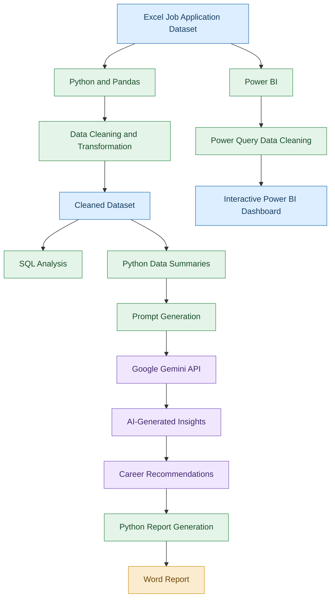

# 🤖 AI Job Hunt Tracker
An AI-Powered Job Application Data Analytics Project


## 📌 Project Overview

The **AI Job Hunt Tracker** is a data analytics and AI-powered project designed to track, manage, and analyse job applications.

The project combines Python, SQL, Power BI, and Google Gemini AI to transform job application data into meaningful insights and actionable career recommendations.

It helps job seekers monitor their application progress, understand job search performance, analyse application trends, and identify areas for improvement.

## 🎯 Problem Statement

Job seekers often apply to multiple companies through different job portals such as LinkedIn, Naukri, Indeed, and company career websites.

Managing application details, interview schedules, application statuses, and follow-ups manually can become difficult.

This project provides a centralized approach to:

- Track job applications.
- Monitor interview and offer progress.
- Analyse job application trends.
- Visualize job search performance.
- Generate AI-based recommendations.

## 🎯 Project Objectives

- Create a centralized job application tracking dataset.
- Clean and transform data using Python and Pandas.
- Perform data analysis using SQL queries.
- Build an interactive Power BI dashboard.
- Integrate Google Gemini API for AI-powered insights.
- Automatically generate a Word report containing AI recommendations.

## 🛠️ Tools and Technologies

| Technology | Purpose |
|---|---|
| Microsoft Excel | Dataset creation and storage |
| Python | Data analysis and automation |
| Pandas | Data cleaning and manipulation |
| SQL | Data querying and analysis |
| Power BI | Interactive dashboard and visualization |
| Google Gemini API | AI-powered analysis and recommendations |
| Google Colab | Python development environment |
| Python-docx | Automated Word report generation |

## 🔄 Project Workflow

The project follows an end-to-end data analytics workflow, from raw data collection to AI-generated recommendations.

### Project Flowchart



## 📊 Project Implementation

### 1. Data Collection – Excel

Created a sample job application dataset containing information such as:

- Application ID
- Company Name
- Job Role
- Location
- Work Mode
- Application Date
- Job Portal
- Required Skills
- Application Status
- Interview Date
- Follow-up Date
- Salary (LPA)

### 2. Data Cleaning and Analysis – Python & Pandas

Performed data preparation and cleaning activities:

- Inspected dataset structure.
- Checked missing values.
- Identified duplicate records.
- Standardized column names.
- Cleaned text values.
- Converted date columns.
- Validated data types.
- Generated summary statistics.

### 3. SQL Analysis

Used SQL to retrieve and analyse job application information.

Concepts practised:

- SELECT and DISTINCT
- WHERE and ORDER BY
- GROUP BY and HAVING
- Aggregate functions
- CASE WHEN
- INNER JOIN and LEFT JOIN

### 4. Interactive Dashboard – Power BI

Developed an interactive dashboard to monitor job search performance.

**Key Performance Indicators (KPIs):**

- Total Applications
- Total Interviews
- Rejected Applications
- Total Offers
- Applied Applications
- Average Salary
- Interview Rate

**Visualizations:**

- Application Status Distribution
- Applications by Job Portal
- Average Salary by Company
- Applications by Location
- Work Mode filtering
- Application Details Table

### 5. AI Integration – Google Gemini API

Integrated Google Gemini API with Python to analyse summarized job application data.

The AI component generates:

- Job search performance analysis.
- Important application trends.
- Job portal observations.
- Interview improvement suggestions.
- Career recommendations.
- Actionable next steps.

The AI receives summarized dataset information through a Python-generated prompt and returns a natural-language analysis.

### 6. Automated Report Generation

Used Python-docx to automatically convert the AI-generated response into a Word document.

The generated report contains AI insights and career recommendations.

## 📈 Sample Dataset Insights

The project uses an illustrative dataset containing 10 fictional job applications.

| Metric | Result |
|---|---:|
| Total Applications | 10 |
| Applied | 5 |
| Interview | 3 |
| Rejected | 1 |
| Offer | 1 |
| Most Used Job Portal | LinkedIn |
| Most Common Job Role | Data Analyst |
| Average Listed Salary | 5.35 LPA |

**Key observations:**

- 50% of applications are in Applied status.
- Data Analyst is the most frequently targeted job role.
- LinkedIn has the highest application count.
- One application resulted in an offer.

These results describe the sample dataset and should not be interpreted as real-world job market statistics.

## 💡 Why AI Was Used

Traditional data analytics helps identify what happened in the job search process.

Generative AI extends the analysis by interpreting summarized information and generating understandable recommendations.

For example:

- Analytics identifies pending applications.
- AI suggests reviewing applications that may need follow-up.
- Analytics identifies application counts by portal.
- AI explains portal usage patterns and suggests further investigation.

The AI component supports decision-making; its recommendations are not guaranteed outcomes.

## ⚙️ How to Run the Project

### Prerequisites

- Python 3.x
- Google Colab
- Microsoft Power BI Desktop
- Google Gemini API key

### Python Libraries

```bash
pip install pandas openpyxl python-docx google-genai
```

### Gemini API Configuration

Store your Gemini API key securely in Google Colab Secrets using the name `GEMINI_API_KEY`.

Example:

```python
from google.colab import userdata
from google import genai

api_key = userdata.get("GEMINI_API_KEY")
client = genai.Client(api_key=api_key)
```

Never hardcode or publish your API key.

### Run AI Analysis

```python
response = client.models.generate_content(
    model="gemini-2.5-flash",
    contents=prompt
)

print(response.text)
```

Note: Model availability and free-tier quotas depend on your Google AI Studio account and current service limits.

## 🚀 Future Improvements

- Develop a Streamlit-based web application.
- Add automated job application reminders.
- Implement portal-wise interview and offer conversion analysis.
- Add advanced AI-powered resume recommendations.
- Include skill gap analysis using job descriptions.
- Expand the dataset with more records.
- Add automated follow-up notifications.

## 📁 Project Structure

```text
AI-Job-Hunt-Tracker/
│
├── data/
│   └── AI_Job_Hunt_Tracker.xlsx
│
├── python/
│   ├── Job_Hunt_Analysis.ipynb
│   └── AI_Insights_Generator.ipynb
│
├── sql/
│   └── SQL_Queries.sql
│
├── powerbi/
│   ├── AI_Job_Hunt_Dashboard.pbix
│   └── Dashboard_Screenshot.png
│
├── reports/
│   └── AI_Job_Hunt_Insights.docx
│
├── README.md
└── .gitignore
```

## ⚠️ Important Disclaimer

This project uses fictional sample job application records for educational and portfolio purposes. The dataset does not represent actual job applications, real job openings, or verified salary information.


**Skills Demonstrated:** Excel | Python | Pandas | SQL | Power BI | Google Gemini API | Data Visualization | AI-Assisted Analytics

---

⭐ If you find this project useful, feel free to explore the repository!
