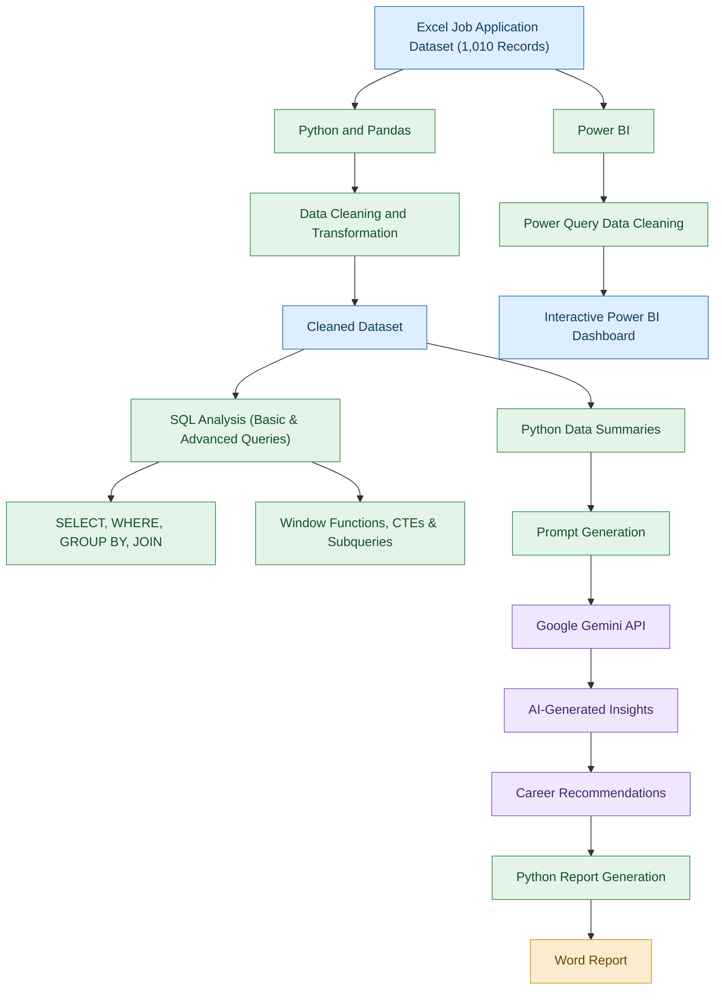

# 🤖 Job Hunt Tracker
### A Data Analytics Project with Generative AI Integration


## 📌 Project Overview

 Job Hunt Tracker is a job application data analytics project that uses Excel, Python, SQL and Power BI to track and analyse job application records.

The project also includes Generative AI integration using the Google Gemini API. Python sends summarized job application data to Gemini, which generates written insights and career recommendations. Python then saves the AI-generated content into a Word report.

The project demonstrates how traditional data analytics tools and Generative AI can be used together to understand job application data.

## 🎯 Problem Statement

Job seekers often apply to multiple companies through different job portals such as LinkedIn, Naukri, Indeed and company career websites.

Keeping track of company names, job roles, application statuses, interview dates and follow-ups can become difficult.

This project explores how data analytics can help organize job application records, monitor application progress and understand job search trends.

## 🎯 Project Objectives

- Create a sample job application dataset using Excel.
- Clean and transform data using Python and Pandas.
- Perform data analysis using SQL.
- Build an interactive Power BI dashboard.
- Integrate Google Gemini API to generate AI-based insights and recommendations.
- Generate a Word report containing AI-generated content using Python.

## 🛠️ Tools and Technologies

| Technology | Purpose |
|---|---|
| Microsoft Excel | Dataset creation and storage |
| Python | Data cleaning, analysis and report generation |
| Pandas | Data manipulation and analysis |
| SQL | Data querying and analysis |
| Power BI | Interactive dashboard and visualization |
| Google Gemini API | Generating insights and recommendations |
| Google Colab | Python development environment |
| Python-docx | Creating Word reports |

## 🔄 Project Workflow

The project follows separate analytics and AI workflows using job application data.

### Project Flowchart
## Project Flowchart

## Project Flowchart


**Note:** Power BI uses the original Excel dataset and performs its own cleaning through Power Query. Python prepares the dataset used for SQL analysis and the summarized information sent to Gemini. The Power BI dashboard and Gemini report are separate outputs.

## 📊 Project Implementation

### 1. Data Collection – Excel

Created a sample dataset containing 10 fictional job application records.

The dataset includes:

- Application ID
- Company Name
- Job Role
- Location
- Work Mode
- Application Date
- Job Portal
- Experience Required
- Required Skills
- Application Status
- Resume Version
- Interview Date
- Follow-up Date
- Salary (LPA)

### 2. Data Cleaning and Analysis – Python & Pandas

Used Python and Pandas to:

- Inspect the dataset.
- Check missing values and duplicate records.
- Standardize column names and text values.
- Convert date columns into appropriate formats.
- Convert salary values into numeric format.
- Validate data types and application records.
- Generate summary statistics.

### 3. SQL Analysis

Used SQL to retrieve and analyse job application information.

**SQL concepts practised:**

- SELECT and DISTINCT
- WHERE and ORDER BY
- GROUP BY and HAVING
- Aggregate functions
- CASE WHEN
- INNER JOIN and LEFT JOIN

### 4. Interactive Dashboard – Power BI

Created an interactive dashboard to visualize job application information.

**Key Performance Indicators:**

- Total Applications
- Total Interviews
- Rejected Applications
- Total Offers
- Applied Applications
- Average Salary
- Interview Rate

**Visualizations:**

- Application Status Distribution
- Applications by Job Portal
- Average Salary by Company
- Applications by Location
- Work Mode Slicer
- Application Details Table

### 5. Generative AI Integration – Google Gemini API

Integrated Google Gemini AI with Python using the Gemini API.

Python prepares summarized information from the job application dataset and sends it to Gemini with a prompt requesting a data-based analysis.

Gemini generates written content such as:

- Job search performance observations.
- Important application trends.
- Job portal recommendations.
- Interview improvement suggestions.
- Career recommendations.
- Actionable next steps.

This demonstrates the use of Generative AI to convert summarized data into natural-language insights and recommendations.

### 6. AI-Generated Word Report

Used the Python-docx library to save Gemini's generated response into a Word document.

**The process:**

1. Python sends summarized data to Gemini.
2. Gemini generates insights and recommendations.
3. Python receives the generated response.
4. Python-docx creates and saves the Word report.

## 📈 Sample Dataset Insights

The project uses an illustrative dataset of 10 fictional job application records.

| Metric | Result |
|---|---:|
| Total Applications | 10 |
| Applied | 5 |
| Interview Status | 3 |
| Rejected | 1 |
| Offer | 1 |
| Total Interview Records / Rounds | 4 |
| Average Listed Salary | 5.35 LPA |

**Additional observations:**

- 50% of applications are in Applied status.
- 30% of applications are in Interview status.
- LinkedIn has the highest application count in the sample, with 4 applications.
- One application has reached the Offer status.

**Note:** The Interview Rate of 30% represents 3 applications marked as Interview out of 10 total applications. The Total Interviews KPI counts 4 interview records or rounds, which is a different measure.

These figures describe only the sample dataset and are not real-world job market statistics.

## 💡 Why Generative AI Was Used

Traditional data analytics helps identify patterns, counts and trends in data.

Generative AI adds another capability: it can generate natural-language explanations and recommendations based on the information provided.

For example:

- Python calculates application status summaries.
- Gemini generates a written explanation of the summarized results.
- Gemini provides general suggestions for improving job search activities.
- Python saves the generated response into a Word report.

**Important:** Gemini does not directly connect to the Power BI dashboard. It receives summarized data through Python and generates a separate report.

## ⚙️ How to Run the Project

### Prerequisites

- Python 3.x
- Google Colab
- Microsoft Power BI Desktop
- Google Gemini API key

### Install Required Libraries

```bash
pip install pandas openpyxl python-docx google-genai
```

### Configure Gemini API

Store your Gemini API key securely in Google Colab Secrets using the name `GEMINI_API_KEY`.

```python
from google.colab import userdata
from google import genai

api_key = userdata.get("GEMINI_API_KEY")
client = genai.Client(api_key=api_key)

print("Gemini API connected successfully!")
```

### Generate AI Insights

```python
response = client.models.generate_content(
    model="gemini-2.5-flash",
    contents=prompt
)

print(response.text)
```

### Save the AI-Generated Report

The generated response can be saved using Python:

```python
from docx import Document

doc = Document()

doc.add_heading("AI Job Hunt Tracker", 0)
doc.add_heading("AI Analysis and Recommendations", level=1)

doc.add_paragraph(response.text)

doc.save("AI_Job_Hunt_Insights.docx")
```

**Security:** Never hardcode or upload your API key to GitHub. Use environment variables or secure notebook secrets.

Gemini model availability and API usage limits depend on your account and Google's current service terms.

## 🚀 Future Improvements

- Develop a Streamlit-based job application tracking interface.
- Add automated job application reminders.
- Analyse portal-wise interview and offer conversion rates.
- Add more real application records.
- Explore AI-assisted resume recommendations.
- Perform skill gap analysis using job descriptions.
- Add automated follow-up notifications.

These are planned enhancements and are not part of the current implementation.

## 📁 Project Structure

```text
AI-Job-Hunt-Tracker/
│
├── data/
│   └── AI_Job_Hunt_Tracker.xlsx
│
├── python/
│   ├── Job_Hunt_Analysis.ipynb
│   └── AI_Insights_Generator.ipynb
│
├── sql/
│   └── SQL_Queries.sql
│
├── powerbi/
│   ├── AI_Job_Hunt_Dashboard.pbix
│   └── Dashboard_Screenshot.png
│
├── reports/
│   └── AI_Job_Hunt_Insights.docx
│
├── README.md
└── .gitignore
```

## ⚠️ Disclaimer

- This project uses fictional sample job application records for educational and portfolio purposes.
- The dataset does not represent actual job applications, live job openings or verified salary information.
- AI-generated recommendations are general suggestions based on the summarized information provided to Gemini. They are not guaranteed career outcomes.
- The project does not automatically search for jobs, submit applications, connect to LinkedIn or Naukri, or predict hiring decisions.

## 📚 Skills Demonstrated

Excel | Python | Pandas | SQL | Power BI | Data Cleaning | Data Analysis | Data Visualization | Google Gemini API | Generative AI Integration | Automated Report Generation

---

⭐ If you find this project useful, feel free to explore the repository!
