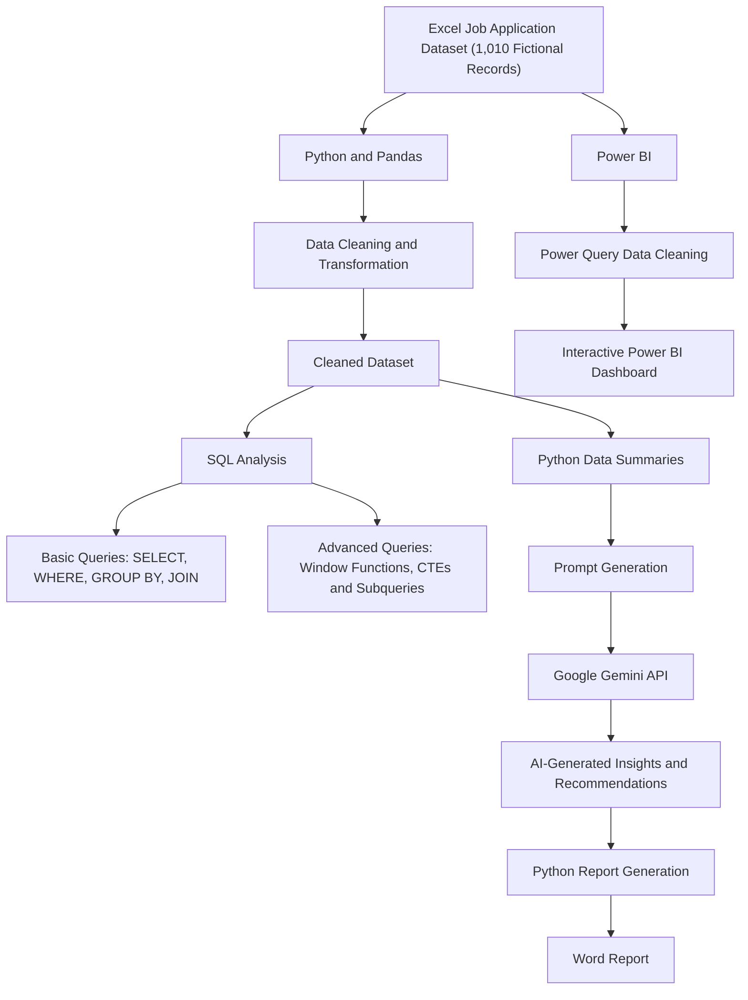

# 🤖 Job Hunt Tracker

### An AI-Integrated Data Analytics Project

A portfolio project combining Excel, Python, SQL, Power BI and the
Google Gemini API to analyse job application data and generate
AI-assisted written insights.

> **Dataset note:** This project uses 1,010 fictional job application
> records for learning and demonstration. The records do not represent
> real applications, candidates, interviews, offers or hiring outcomes.

------------------------------------------------------------------------

## 📌 Project Overview

Job Hunt Tracker is a data analytics project built around a fictional
job application dataset. Excel is used to store the data, Python and
Pandas are used for data cleaning and summaries, SQL is used to query
and analyse the records, and Power BI is used to create an interactive
dashboard.

The project also includes a Generative AI component. Python sends
summarized job application information and a prompt to the Google Gemini
API. Gemini generates written observations and general career
recommendations, which Python saves into a Word report.

The Power BI dashboard and Gemini-generated report are separate outputs.
Gemini is not directly connected to the Power BI dashboard.

## 🎯 Problem Statement

Job seekers may apply to multiple companies through different job
portals. Keeping track of company names, job roles, application dates,
statuses, locations and follow-ups can become difficult.

This project explores how data analytics can be used to organize
fictional job application records, review application patterns and
present useful summaries.

## 🎯 Project Objectives

-   Create and maintain a fictional job application dataset.
-   Clean and transform data using Python and Pandas.
-   Query and analyse application records using SQL.
-   Practise basic and advanced SQL concepts.
-   Build an interactive Power BI dashboard.
-   Integrate the Google Gemini API with Python.
-   Generate AI-assisted written insights and career recommendations.
-   Save the generated content in a Word report.

## 🛠️ Tools and Technologies

  -----------------------------------------------------------------------
  Technology                          Purpose
  ----------------------------------- -----------------------------------
  Microsoft Excel                     Dataset creation and storage

  Python                              Data processing, summaries and
                                      report generation

  Pandas                              Data cleaning and manipulation

  SQL                                 Data querying and analysis

  Power BI                            Dashboard and visualisation

  Power Query                         Data cleaning in Power BI

  Google Gemini API                   AI-generated written insights and
                                      recommendations

  Google Colab                        Python development environment

  python-docx                         Word report generation
  -----------------------------------------------------------------------

## 🔄 Project Workflow

The project has three related but separate paths: Python and SQL
analysis, Power BI dashboard development, and Gemini-assisted report
generation.



**Workflow note:** Power BI imports the Excel dataset and performs its
own cleaning in Power Query. Python prepares data for SQL analysis and
creates summarized information for Gemini. The dashboard and Word report
are separate project outputs.

## 📊 Dataset

The dataset contains **1,010 fictional job application records**. Fields
include:

-   Application ID
-   Company Name
-   Job Role
-   Location
-   Work Mode
-   Application Date
-   Job Portal
-   Experience Required
-   Required Skills
-   Application Status
-   Resume Version
-   Interview Date
-   Follow-up Date
-   Salary (LPA)
-   Job URL

All records are illustrative sample data.

## 📊 Project Implementation

### 1. Dataset Preparation -- Excel

Created and expanded a fictional job application dataset for analysis
and demonstration.

### 2. Data Cleaning and Summaries -- Python and Pandas

Used Python and Pandas to inspect, clean, transform and summarize the
dataset. This included checking missing values and duplicates,
standardising text values, handling date and numeric fields, and
generating summary information.

### 3. SQL Analysis

Used SQL to retrieve and analyse job application records.

**SQL concepts included:**

-   `SELECT` and `DISTINCT`
-   `WHERE` and `ORDER BY`
-   `GROUP BY` and `HAVING`
-   Aggregate functions
-   `CASE WHEN`
-   `INNER JOIN` and `LEFT JOIN`
-   Window functions, including `RANK()` and running totals
-   Common Table Expressions (CTEs)
-   Subqueries

### 4. Interactive Dashboard -- Power BI

Imported the Excel dataset into Power BI and performed data cleaning
separately using Power Query.

The dashboard includes KPI cards and visuals for:

-   Total Applications
-   Average Salary (LPA)
-   Rejected Applications
-   Total Offers
-   Applied Applications
-   Interview Applications
-   Application Status Distribution
-   Applications by Job Portal
-   Applications by Location
-   Average Salary by Company
-   Work Mode filter
-   Application details table

### 5. Generative AI Integration -- Google Gemini API

Integrated the Google Gemini API with Python.

Python prepares summarized information from the dataset and sends it to
Gemini along with a prompt. Gemini returns natural-language observations
and general career recommendations based on the information provided.

The AI output may include observations about supplied application
summaries, application and job-portal trends, general job-search
suggestions, interview preparation suggestions, and possible next steps.

These are AI-generated suggestions, not verified facts or guaranteed
career outcomes.

### 6. AI-Generated Word Report

Used Python and `python-docx` to save the generated Gemini response into
a Word document.

**Process:**

1.  Python prepares summarized dataset information and a prompt.
2.  Python sends the prompt to the Gemini API.
3.  Gemini returns a text response.
4.  Python receives the response.
5.  Python-docx saves the content in a Word report.

## 📈 Sample Dataset Insights

The following figures describe the 1,010 fictional records in this
project. They are not real-world job-market statistics.

### Application status distribution

  Current status       Records      Share
  ---------------- ----------- ----------
  Applied                  425     42.08%
  Interview                211     20.89%
  Rejected                 144     14.26%
  Shortlisted              127     12.57%
  Offer                     52      5.15%
  Withdrawn                 51      5.05%
  **Total**          **1,010**   **100%**

### Job portal distribution

  Job portal            Records      Share
  ----------------- ----------- ----------
  Indeed                    223     22.08%
  Company Website           215     21.29%
  Internshala               198     19.60%
  Naukri                    190     18.81%
  LinkedIn                  184     18.22%
  **Total**           **1,010**   **100%**

### Other summary

  Metric                          Result
  --------------------------- ----------
  Total application records        1,010
  Average listed salary         8.44 LPA

**How to interpret these figures:**

-   `Interview` means 211 records currently have the Interview status;
    it does not mean 211 interview rounds took place.
-   `Offer` means 52 sample records are labelled Offer. It is not a
    candidate conversion rate or evidence of real offers.
-   Average listed salary is the mean of the `Salary_LPA` values in the
    sample. It is not salary actually received or a confirmed expected
    salary.
-   Portal counts show the number of sample records associated with each
    portal. They do not establish which portal performs best.

## 💡 Why Generative AI Was Used

Traditional analytics helps calculate metrics and identify patterns.
Generative AI can add natural-language explanations and suggestions
based on summaries supplied to the model.

In this project, Python prepares the dataset summaries, Gemini generates
written observations and general recommendations from the prompt and
supplied summaries, and Python saves the generated response in a Word
report.

**Important:** Gemini does not directly analyse the Power BI dashboard,
search for live jobs, submit applications, connect to LinkedIn or
Naukri, or predict hiring decisions.

## ⚙️ How to Run the Gemini API Example

### Prerequisites

-   Python 3.x
-   Google Colab
-   A Google Gemini API key
-   Required Python libraries

### Install libraries

``` bash
pip install pandas openpyxl python-docx google-genai
```

### Configure the Gemini API

Store your API key securely in Google Colab Secrets with the name
`GEMINI_API_KEY`. Do not paste the actual key into a notebook that will
be shared publicly.

``` python
from google.colab import userdata
from google import genai

api_key = userdata.get("GEMINI_API_KEY")
client = genai.Client(api_key=api_key)

print("Gemini API connected successfully!")
```

### Send a prompt to Gemini

In the project notebook, `prompt` represents the prompt prepared using
the relevant summarized dataset information.

``` python
response = client.models.generate_content(
    model="gemini-2.5-flash",
    contents=prompt
)

print(response.text)
```

### Save the response as a Word report

``` python
from docx import Document

doc = Document()
doc.add_heading("Job Hunt Tracker", 0)
doc.add_heading("AI-Generated Insights and Recommendations", level=1)
doc.add_paragraph(response.text)
doc.save("AI_Job_Hunt_Insights.docx")
```

Model availability and API usage limits may change and depend on
Google's current service terms and the account being used.

## 🚀 Future Improvements

Possible future enhancements include:

-   Build a Streamlit interface for easier data entry and tracking.
-   Add reminders for application follow-ups.
-   Analyse portal-wise interview and offer rates using clearly defined
    measures.
-   Add real, permissioned application records.
-   Explore AI-assisted resume feedback.
-   Compare skills in a job description with a user's skills.

These are ideas for future development and are not features of the
current project.

## 📁 Example Project Structure

Update the filenames below to match the files included in your
repository.

``` text
Job-Hunt-Tracker/
├── data/
│   └── Job_Hunt_Tracker_1000_Extra_Records.xlsx
├── python/
│   ├── Job_Hunt_Analysis.ipynb
│   └── AI_Insights_Generator.ipynb
├── sql/
│   └── SQL_Queries.sql
├── powerbi/
│   ├── AI_Job_Hunt_Dashboard.pbix
│   └── Dashboard_Screenshot.png
├── reports/
│   └── Job_Hunt_Tracker_Corrected_AI_Insights_Report.docx
├── README.md
└── .gitignore
```

## ⚠️ Disclaimer

-   This project uses fictional sample job application records for
    educational and portfolio purposes.
-   The records do not represent actual job applications, candidates,
    interviews, offers or hiring outcomes.
-   Salary values are sample listed values, not verified salary
    information.
-   AI-generated content is based on the summarized information and
    prompt provided to Gemini. It may contain errors or general
    suggestions and should be reviewed.
-   The project does not automatically search for jobs, submit
    applications, connect to job portals, or predict hiring decisions.

## 📚 Skills Demonstrated

Excel | Python | Pandas | SQL | Data Cleaning | Data Analysis |
Window Functions | CTEs | Subqueries | Power BI \| Power Query |
Data Visualisation | Google Gemini API | Generative AI Integration |
API Integration | Word Report Generation

------------------------------------------------------------------------

⭐ Thanks for checking out this project!
